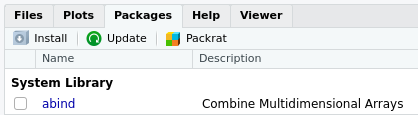

# Ce cours

## Où nous allons

Le cours est découpé en cinq chapitres :

| Chapitre | Objet |
|:--|:--|
| 1 | Premiers pas : objets, types, vecteurs, fonctions |
| 2 | Découvrir un tableau de données |
| 3 | Décrire des données |
| 4 | Représenter des données |
| 5 | Projet : une analyse complète |

À la fin, vous serez capables de prendre un jeu de données, de le décrire et d'en tirer des graphiques lisibles.

Trois principes guident le cours.
D'abord, **un seul jeu de données** du début à la fin : l'enquête *Histoire de vie* de l'INSEE, à partir du chapitre 2.
Vous finirez par bien le connaître, et c'est voulu : quand les données vous sont familières, vous repérez plus facilement un résultat qui cloche.
Ensuite, **une seule famille d'outils**, le `tidyverse`, que nous adopterons à partir du chapitre 2.
Aujourd'hui, nous apprenons les bases de R sur lesquelles il repose.
Enfin, **des exercices interactifs** avec `swirl` à la fin de chaque chapitre.
À partir du chapitre 2, chaque chapitre s'ouvre aussi par un court exercice de reprise sur le chapitre précédent.

## Comment lire ces pages

Ouvrez RStudio à côté de cette page.
Chaque fois que vous rencontrez un bloc de code, recopiez-le et exécutez-le.
Recopiez-le plutôt que de le coller : taper le code vous oblige à le lire, et vous fera commettre les fautes de frappe qu'il vaut mieux apprendre à reconnaître tout de suite.

Prenez aussi l'habitude de **prédire avant d'exécuter** : avant de lancer une commande, demandez-vous ce que R va afficher.
Si le résultat correspond à ce que vous attendiez, vous avez compris.
Sinon, c'est que quelque chose vous échappe, et c'est le moment de s'arrêter pour comprendre, pas de passer à la suite.

## Une remarque sur les assistants IA

Vous pouvez tout à fait utiliser ChatGPT, Gemini ou Claude en dehors de ce cours.
Ils vous donneront presque toujours une réponse, parfois fausse, et pas toujours simple à comprendre.

::: {.callout-important}
Le problème n'est pas qu'ils se trompent : c'est que vous ne pouvez pas le voir tant que vous ne savez pas faire sans eux.
Ce cours sert à acquérir de quoi les juger.

Quand vous êtes bloqués, servez-vous de l'aide de R et des messages d'erreur.
C'est ce que vous apprendrez ici.
:::

La charte IA de l'université est disponible ici : <https://www.univ-paris8.fr/IMG/pdf/02_chartes_cadre_ia_up8.pdf>.

# R comme calculatrice

## La console

Au premier lancement de RStudio, la fenêtre est organisée en trois grandes zones.

```{r rstudio}
#| out-width: '100%'
#| echo: false
#| fig-align: center
#| fig-cap: "Accueil RStudio"
knitr::include_graphics(file.path("resources", "fenetreRStudio.png"))
```

La zone de gauche s'appelle **la console**.
Au démarrage, RStudio a lancé R, et c'est dans cette zone que nous allons pouvoir dialoguer avec lui.

La console affiche un texte de bienvenue, suivi d'une ligne commençant par le caractère `>`.
C'est l'**invite de commande** : R attend vos instructions.
Cliquez dans la console, tapez le texte suivant et appuyez sur `Entrée`.

```{r addition}
2+2
```

R affiche le résultat, puis le symbole `>` réapparaît : il attend la commande suivante.
Essayez d'autres opérations :

```{r calculs}
5-7
4*12
-10/3
5^2
```

Ne vous préoccupez pas du `[1]` qui précède chaque résultat, nous l'expliquerons plus bas.

## Les opérations arithmétiques

Le tableau suivant récapitule les opérations de base et leur écriture en R.

| Math          | code `R`    | Résultat    |
|:-------------:|:-------:|:---------:|
| $3 + 2$       | `3 + 2` | `r 3 + 2` |
| $3 - 2$       | `3 - 2` | `r 3 - 2` |
| $3 \times 2$    | `3 * 2` | `r 3 * 2` |
| $3 \div 2$       | `3 / 2` | `r 3 / 2` |
| $3^2$        | `3 ^ 2`         | `r 3 ^ 2`         |
| $\sqrt{100}$ | `sqrt(100)`     | `r sqrt(100)`     |

: Principales opérations arithmétiques

R dispose aussi des fonctions mathématiques usuelles.
Vous n'en aurez pas besoin dans la suite de ce cours, mais elles vous serviront ailleurs, en économétrie notamment.

| Math          | code `R`    | Résultat    |
|:------------:|:---------------:|:-----------------:|
| $\pi$        | `pi`            | `3.141593`            |
| $e$          | `exp(1)`        | `2.718282`        |
| $\ln(x)$         | `log(x)`       | logarithme naturel       |
| $\log_{10}(1000)$ | `log10(1000)`       | `3`       |
| $10^2$       | `1e2`           | `r 1e2`           |

: Constantes et fonctions usuelles

::: {.callout-note}
Attention : il n'y a pas de fonction `ln()` en R.
Le logarithme naturel s'écrit `log()`.
:::

## Espaces et lisibilité

À de rares exceptions près, R ne tient pas compte des espaces autour des commandes.
Les trois commandes suivantes sont équivalentes :

```{r espaces}
#| eval: false
10+2
10 + 2
10       +         2
```

L'usage est d'adopter la deuxième écriture, avec une espace de part et d'autre de l'opérateur : c'est la plus lisible.

## Quand R attend la suite

Il arrive qu'on valide une commande incomplète, par exemple `4 *` sans le second nombre.
R ne renvoie alors pas de résultat : il remplace l'invite `>` par un `+`, pour signaler qu'il attend la suite de la commande.

```{r incomplet}
#| eval: false

> 4 *
+
```

Vous pouvez soit compléter la commande (tapez `3` puis `Entrée`), soit appuyer sur `Échap` pour l'abandonner et retrouver une invite normale.
Si R semble ne plus vous répondre, regardez d'abord le début de la dernière ligne de la console : un `+` à la place du `>` en est presque toujours la cause.

# Objets

## Stocker une valeur

Nous savons utiliser R comme une calculatrice.
Pour aller plus loin, il faut pouvoir conserver un résultat afin de le réutiliser.
On le stocke pour cela dans un **objet**, à l'aide de l'opérateur d'**assignation** `<-`.

Cette « flèche » prend ce qui se trouve à sa droite et le range dans un objet dont le nom est indiqué à sa gauche.

```{r assignation}
x <- 2
```

Cette ligne se lit : « prends la valeur 2 et mets-la dans un objet qui s'appelle `x` ».
Remarquez que R n'affiche rien : une assignation ne produit pas d'affichage.
Pour voir le contenu d'un objet, il suffit de taper son nom :

```{r lecture}
x
```

## Utiliser un objet

On peut ensuite utiliser cet objet dans d'autres opérations : R le remplace alors par sa valeur.

```{r valeur}
x + 4
```

On peut créer autant d'objets qu'on le souhaite, et les combiner entre eux :

```{r multiple_objets}
x <- 2
y <- 5
resultat <- x + y
resultat
```

## Remplacer la valeur d'un objet

Si l'on assigne une nouvelle valeur à un objet existant, la précédente est perdue, sans avertissement :

```{r nouvelle_assignation}
x <- 2
x <- 5
x
```

Assigner un objet à un autre copie simplement la valeur de droite dans l'objet de gauche.
Avant d'exécuter les lignes suivantes, essayez de prédire ce que vaudra `x` à la fin.

```{r copie}
#| eval: false
x <- 1
y <- 3
x <- y
x
```

Les deux objets ne sont pas « liés » pour autant : si vous modifiez `y` ensuite, `x` garde la valeur 3.

## Exercice

Dans la console :

1. Créez un objet `age` contenant votre âge, et un objet `prenom` contenant votre prénom (entre guillemets : `prenom <- "Camille"`).
2. Créez un objet `annee_naissance`, calculé à partir de `age`.
3. Que se passe-t-il si vous tapez `Age` au lieu de `age` ?
4. Peut-on mettre une espace dans un nom d'objet ? Un chiffre au début ?

Ne sautez pas la question 3 : elle vous fait rencontrer votre premier message d'erreur.
Nous verrons plus bas comment le lire.

::: {.callout-note collapse="true" title="Correction"}
Par exemple :

```{r ex_objets_correction}
#| eval: false
age <- 20
prenom <- "Camille"
annee_naissance <- 2026 - age   # remplacez 2026 par l'année en cours
annee_naissance
```

Le calcul de `annee_naissance` n'est exact qu'à un an près : il dépend de la date de votre anniversaire.

Taper `Age` provoque une erreur :

    Erreur : objet 'Age' introuvable

R distingue les majuscules des minuscules : pour lui, `age` et `Age` sont deux noms différents, et seul le premier existe.

Une espace ou un chiffre au début d'un nom provoquent aussi une erreur :

```{r ex_objets_noms}
#| eval: false
mon age <- 20
2age <- 20
```

    Erreur : symbole inattendu dans "mon age"

Un nom d'objet commence par une lettre, et ne contient que des lettres, des chiffres, des points et des tirets bas.
Pour séparer plusieurs mots, on utilise le tiret bas, comme dans `annee_naissance`.
:::

# Types

## Chaînes de caractères

Les valeurs stockées dans les objets peuvent être de différents **types**.
Jusqu'ici, nous n'avons manipulé que des nombres.
Un objet peut aussi contenir du texte, qu'on appelle une **chaîne de caractères**.
On la délimite par des guillemets, simples ou doubles (`'` ou `"`) :

```{r chaines}
chien <- "Chihuahua"
chien
```

Les guillemets sont indispensables : sans eux, R croirait que `Chihuahua` est le nom d'un objet, et le chercherait.

## Booléens

Un objet peut enfin contenir une **condition logique**, qui vaut `TRUE` (vrai) ou `FALSE` (faux).
On appelle ces valeurs des **booléens**.
Elles résultent le plus souvent d'une comparaison :

```{r booleen}
valeur <- TRUE
valeur

chien == "Doberman"
3 < 2
```

## Opérateurs logiques

Voici les opérateurs qui produisent des booléens :

| Opérateur | Résumé | Exemple | Résultat |
|:---------|:---------------------:|:---------------------:|:-------:|
| `x < y`  | `x` plus petit que `y`                | `3 < 42`               | `r 3 < 42`               |
| `x > y`  | `x` plus grand que `y`             | `3 > 42`               | `r 3 > 42`               |
| `x <= y` | `x` plus petit ou égal à `y`    | `3 <= 42`              | `r 3 <= 42`              |
| `x >= y` | `x` plus grand ou égal à `y` | `3 >= 42`              | `r 3 >= 42`              |
| `x == y` | `x` égal à `y`                  | `3 == 42`              | `r 3 == 42`              |
| `x != y` | `x` différent de `y`              | `3 != 42`              | `r 3 != 42`              |
| `!x`     | non `x`                          | `!(3 > 42)`            | `r !(3 > 42)`            |
| `x | y`  | `x` ou `y`     |     `(3 > 42) | TRUE`  | `r TRUE`      |
| `x & y`  | `x` et `y`                      | `(3 < 4) & (42 > 13)` | `r (3 < 4) & ( 42 > 13)` |

::: {.callout-warning}
La comparaison s'écrit `==`, avec deux signes égal.
Un seul `=` ne compare pas : il assigne.
C'est l'erreur la plus fréquente au début, et elle ne provoque pas toujours de message.
:::

Ces opérateurs vous serviront pendant tout le cours.
Dès le chapitre 2, ils permettront de sélectionner des lignes dans un tableau, par exemple les enquêtés de moins de 25 ans :

```{r apercu}
#| eval: false
d |> filter(age < 25)
```

Ne cherchez pas encore à comprendre le reste de cette ligne : retenez seulement que `age < 25` est une comparaison comme celles du tableau ci-dessus.

# Vecteurs

## Regrouper plusieurs valeurs

Imaginons qu'on ait demandé leur taille en centimètres à cinq personnes, et qu'on veuille calculer leur taille moyenne.
Plutôt que de créer cinq objets, on range les cinq valeurs dans un seul objet, appelé **vecteur** :

```{r tailles}
tailles <- c(156, 164, 197, 147, 173)
tailles
```

La fonction `c()` signifie « combine les valeurs suivantes en un vecteur ».
Les valeurs sont séparées par des virgules.

## Calculer sur un vecteur

Une opération appliquée à un vecteur s'applique à chacun de ses éléments :

```{r op_vec}
tailles + 10
tailles^2
```

Imaginons qu'on ait aussi demandé leur poids en kilos aux cinq mêmes personnes :

```{r poids}
poids <- c(45, 59, 110, 44, 88)
```

On peut alors calculer l'indice de masse corporelle de chacune, en divisant le poids en kilos par le carré de la taille en mètres.
R fait le calcul élément par élément : le premier poids avec la première taille, le deuxième avec la deuxième, et ainsi de suite.

```{r imc}
imc <- poids / (tailles / 100) ^ 2
imc
```

Une seule ligne calcule les cinq indices.
C'est le principe central de R : on travaille sur des colonnes entières, pas sur des valeurs une par une.
Vous le retrouverez dès le chapitre suivant, quand chaque colonne d'un tableau de données sera un vecteur.

## Un vecteur n'a qu'un seul type

Un vecteur peut contenir du texte :

```{r diplome}
diplome <- c("CAP", "Bac", "Bac+2", "CAP", "Bac+3")
diplome
```

En revanche, toutes ses valeurs doivent être du même type.
Si on mélange texte et nombres, R ne refuse pas : il convertit tout en texte.
Prédisez le résultat avant d'exécuter :

```{r coercition}
#| eval: false
chiens <- c("Chihuahua", 5, "Doberman", 15)
chiens
```

::: {.callout-warning}
Remarquez les guillemets autour de `"5"` et `"15"` : R a transformé les nombres en texte, sans prévenir.
Vous ne pourrez plus faire de calcul avec.
C'est une source d'erreur classique lors de l'import de données : il suffit d'une case contenant du texte dans une colonne de nombres pour que toute la colonne devienne du texte.
:::

## Créer une suite d'entiers

L'opérateur `:` crée un vecteur contenant tous les entiers entre deux valeurs :

```{r sequence}
x <- 1:10
x
```

## Accéder à un élément

On accède à un élément d'un vecteur en faisant suivre son nom de crochets contenant sa position.
On peut aussi demander plusieurs positions à la fois, en les combinant avec `c()` :

```{r lecture_vecteur}
diplome[2]
tailles[c(1, 3)]
```

## Le `[1]` de l'affichage

Si un vecteur contient beaucoup d'éléments, R répartit l'affichage sur plusieurs lignes :

     [1] 294 425 339 914 114 896 716 648 915 587 181 926 489
    [14] 848 583 182 662 888 417 133 146 322 400 698 506 944
    [27] 237 324 333 443 487 658 793 288 897 588 697 439 697

Le nombre entre crochets au début de chaque ligne indique la **position du premier élément de la ligne**.
Ainsi, 848 est le 14ᵉ élément du vecteur.

C'est ce qui explique le `[1]` affiché devant chaque résultat depuis le début : pour R, un nombre seul est un vecteur à un élément.

# Fonctions

## Utiliser une fonction

Une **fonction** a un *nom*, prend des *arguments* entre parenthèses, et renvoie un *résultat*.
Vous en avez déjà utilisé deux : `sqrt()` et `c()`.
En voici deux autres, qui donnent le nombre d'éléments d'un vecteur et sa moyenne :

```{r length}
length(tailles)
mean(tailles)
```

## Les arguments

Certaines fonctions prennent plusieurs arguments.
Le premier est en général la donnée sur laquelle on travaille ; les suivants modifient le comportement de la fonction, et on les désigne par leur nom.

Supposons qu'une des cinq personnes n'ait pas donné sa taille.
R représente une valeur manquante par `NA` (pour *Not Available*) :

```{r arguments}
tailles_incompletes <- c(156, 164, NA, 147, 173)
mean(tailles_incompletes)
mean(tailles_incompletes, na.rm = TRUE)
```

Le premier résultat est `NA` : la moyenne d'un ensemble qui contient une valeur inconnue est elle-même inconnue.
R refuse de deviner.
L'argument `na.rm = TRUE` (pour *NA remove*) lui demande d'écarter les valeurs manquantes avant de calculer.
La moyenne porte alors sur quatre personnes, et non sur cinq : nous reviendrons au chapitre 3 sur ce que cela implique.

## L'aide d'une fonction

Chaque fonction de R est documentée.
On affiche sa page d'aide avec `?`, ou avec la fonction `help()` :

```{r help}
#| eval: false
?mean
help("mean")
```

L'aide s'affiche dans le panneau en bas à droite de RStudio.
Elle est technique, souvent en anglais, mais elle est exacte et toujours disponible, même sans connexion.

Deux rubriques suffisent au début.
La rubrique **Usage** donne la liste des arguments de la fonction et leur valeur par défaut.
La rubrique **Examples**, tout en bas, contient des exemples que vous pouvez copier dans la console pour voir la fonction à l'œuvre.

## Exercice

Sur le vecteur `imc` calculé plus haut :

1. Combien contient-il de valeurs ?
2. Quelle est la plus petite ? la plus grande ? Les fonctions s'appellent comme en anglais ; cherchez dans l'aide si besoin.
3. Ouvrez `?quantile`. Que fait l'argument `probs` ?
4. Calculez la médiane des tailles de deux façons différentes.

::: {.callout-note collapse="true" title="Correction"}
```{r ex_imc_correction}
length(imc)
min(imc)
max(imc)
```

`range(imc)` aurait donné le minimum et le maximum d'un coup.

L'argument `probs` de `quantile()` indique la ou les proportions voulues, entre 0 et 1 : `0.5` donne la médiane, `0.25` le premier quartile.
Sans cet argument, `quantile()` renvoie le minimum, les trois quartiles et le maximum.

```{r ex_mediane_correction}
median(tailles)
quantile(tailles, probs = 0.5)
```

Les deux résultats sont identiques ; `quantile()` y ajoute seulement une étiquette, `50%`.
:::

# Quand ça ne marche pas

## Lire un message d'erreur

Vous allez rencontrer beaucoup de messages d'erreur, et c'est normal.
Ces messages sont brefs, mais ils désignent presque toujours l'endroit exact du problème.
Apprendre à les lire est la compétence la plus utile de ce cours : c'est elle qui vous permettra de vous débloquer seuls.

Tapez la commande suivante :

```{r erreur_objet}
#| eval: false
taille
```

R répond :

    Erreur : objet 'taille' introuvable

Il vous dit qu'il ne connaît aucun objet portant ce nom.
Et en effet, notre vecteur s'appelle `tailles`, au pluriel.

## Trois autres erreurs courantes

La fonction n'existe pas, ici à cause d'une faute de frappe :

```{r erreur_fonction}
#| eval: false
means(tailles)
```

    Erreur : impossible de trouver la fonction "means"

On essaie de calculer avec du texte.
Les guillemets font de `"12"` une chaîne de caractères, et on ne peut pas additionner du texte et un nombre :

```{r erreur_type}
#| eval: false
"12" + 3
```

    Erreur : argument non numérique pour un opérateur binaire

Une parenthèse n'est pas fermée.
Il n'y a pas de message cette fois : R affiche un `+` et attend la suite, comme nous l'avons vu plus haut.
Appuyez sur `Échap`, puis corrigez la commande.

```{r erreur_parenthese}
#| eval: false
mean(tailles
```

    +

## La méthode

Face à un message d'erreur, procédez dans l'ordre.

1. **Lisez la dernière ligne** du message : c'est là que R dit ce qui ne va pas.
2. **Repérez le nom cité entre guillemets** : c'est presque toujours là qu'est la faute.
3. **Comparez-le à ce que vous avez tapé**. Faute de frappe, singulier au lieu du pluriel, majuscule oubliée : R distingue `age` de `Age`.
4. **Si le nom est correct**, c'est que l'objet n'existe pas encore : avez-vous exécuté la ligne qui le crée ?

::: {.callout-important}
Un message d'erreur n'est pas un échec, c'est un diagnostic.
Le vrai danger, ce sont les commandes qui s'exécutent sans rien dire et donnent un résultat faux.
Vous en avez déjà vu deux exemples : le `=` à la place de `==`, et les nombres convertis en texte dans un vecteur.
Nous y reviendrons en détail au chapitre 3.
:::

# Scripts

## Pourquoi un script

Jusqu'ici, nous avons tapé les commandes une à une dans la console.
Rien n'est conservé : si vous fermez RStudio, tout est perdu, et il faut tout retaper.

Un **script** est un fichier texte qui contient vos commandes.
On le crée avec le menu *File > New File > R Script* (*Fichier > Nouveau fichier > Script R*).
Il s'ouvre dans une nouvelle zone, en haut à gauche, au-dessus de la console.
Créez-en un, recopiez-y le code suivant, et enregistrez-le (`Ctrl + S`) :

```{r script}
#| eval: false
# Tailles et poids de cinq enquêtés
tailles <- c(156, 164, 197, 147, 173)
poids <- c(45, 59, 110, 44, 88)

mean(tailles)
mean(poids)

# Indice de masse corporelle
imc <- poids / (tailles / 100) ^ 2
min(imc)
max(imc)
```

## Exécuter et commenter

Écrire une commande dans un script ne l'exécute pas.
Pour l'envoyer à la console, placez le curseur sur la ligne et appuyez sur `Ctrl + Entrée` (`Cmd + Entrée` sur Mac).
Si vous sélectionnez plusieurs lignes, `Ctrl + Entrée` les exécute toutes.
Le résultat s'affiche dans la console, comme si vous aviez tapé la commande vous-mêmes.

Tout ce qui suit un `#` sur une ligne est ignoré par R : c'est un **commentaire**, écrit pour les humains qui liront le script, à commencer par vous.

::: {.callout-tip}
Commentez ce que vous cherchez à faire, pas ce que fait la ligne.
`# calcule la moyenne` au-dessus de `mean(x)` n'apprend rien à personne.
`# on écarte les non-répondants` est utile.
:::

À partir de maintenant, travaillez toujours dans un script, jamais directement dans la console.
C'est aussi sous forme de script que vous rendrez votre projet final.

# Paquets

## Installer un paquet

R est livré avec un ensemble de fonctions de base.
Des milliers d'autres sont distribuées sous forme d'extensions appelées **paquets** (*packages*), diffusés sur un réseau de serveurs nommé [CRAN](https://cran.r-project.org/).

On installe un paquet avec `install.packages()`, en mettant son nom entre guillemets.
Installez maintenant le paquet `questionr`, qui contient les données que nous utiliserons à partir du chapitre suivant :

```{r install}
#| eval: false
install.packages("questionr")
```

On peut aussi passer par l'onglet *Packages* de RStudio, en bas à droite, et son bouton *Install* :



L'installation se fait **une seule fois** par ordinateur, comme pour n'importe quel logiciel.
Ne laissez donc pas de `install.packages()` dans vos scripts.

## Charger un paquet

L'installation ne suffit pas : il faut aussi **charger** le paquet, avec `library()`, à chaque fois que vous relancez RStudio.
Cette fois, les guillemets ne sont pas nécessaires.

```{r library}
#| eval: false
library(questionr)
```

On regroupe en général tous les appels à `library()` au début du script, pour qu'ils s'exécutent en premier :

```{r librairies}
#| eval: false
library(tidyverse)
library(questionr)
```

::: {.callout-warning}
Si R vous répond `impossible de trouver la fonction`, alors que le nom de la fonction est bien écrit, c'est presque toujours qu'un `library()` n'a pas été exécuté.
:::

# À vous : les leçons swirl

## Installer swirl

`swirl` est un paquet qui vous fait pratiquer R de manière interactive, directement dans la console : il vous pose des questions, vous tapez les commandes, il vous corrige.
Installez-le, chargez-le, puis indiquez-lui que vous souhaitez travailler en français :

```{r swirl}
#| eval: false
install.packages("swirl")
library(swirl)
select_language("french", append_rprofile = TRUE)
```

Installez ensuite le cours de cette matière.
Il est disponible sur GitHub, à l'adresse <https://github.com/EliasBcd/InitiationR>, et s'installe directement depuis R :

```{r lecon}
#| eval: false
install_course_github("EliasBcd", "InitiationR")
```

## Lancer une leçon

```{r lancement_swirl}
#| eval: false
swirl()
```

swirl vous demande d'abord un nom.
Donnez votre numéro d'étudiant ou votre nom, et **gardez le même toute l'année** : swirl s'en sert pour retrouver votre progression.
Choisissez ensuite le cours « InitiationR », puis la leçon, et suivez les instructions qui s'affichent dans la console.
Si swirl refuse une réponse qui vous semble juste, lisez la partie [Si vous êtes bloqués](Swirl.qmd#sec-bloque) de la page sur swirl.

Pour ce chapitre, faites dans l'ordre les leçons **Manipulations_simples**, **Types**, **Vecteurs**, **Messages_erreurs**, **Fonctions** puis **Logique**.

## Déposer votre travail

À la fin de chaque leçon, swirl vous propose de soumettre votre progression.
Répondez « Oui » : R ouvre votre navigateur sur la page Moodle où déposer le fichier `.txt` de la leçon.
La page [Utiliser swirl](Swirl.qmd) explique où trouver ce fichier si besoin.

::: {.callout-note}
C'est ce dépôt qui valide votre travail.
Faites-le à chaque leçon terminée.
:::

Si le cours semble ne pas fonctionner, réinstallez-le :

```{r reinstallation}
#| eval: false
uninstall_course("InitiationR")
install_course_github("EliasBcd", "InitiationR")
```

## Pour aller plus loin

Si vous voulez pratiquer davantage, la leçon facultative **Exercice_1** reprend les vecteurs et les fonctions de base.
La liste des leçons facultatives est disponible dans [`LECONS_OPTIONNELLES.md`](https://github.com/EliasBcd/InitiationR/blob/main/LECONS_OPTIONNELLES.md).

Le manuel de Julien Barnier, [*Introduction à R et au tidyverse*](https://juba.github.io/tidyverse/), en français et en ligne, est une bonne référence pour revoir une notion à votre rythme.
Ce n'est pas un travail à faire : consultez-le librement, quand vous en avez besoin.

# La suite

Avant de passer au chapitre suivant, terminez les six leçons swirl et déposez-les sur Moodle.
Il n'y a rien d'autre à faire.

Au chapitre suivant, nous abandonnons les vecteurs saisis à la main pour travailler sur de vraies données d'enquête.
