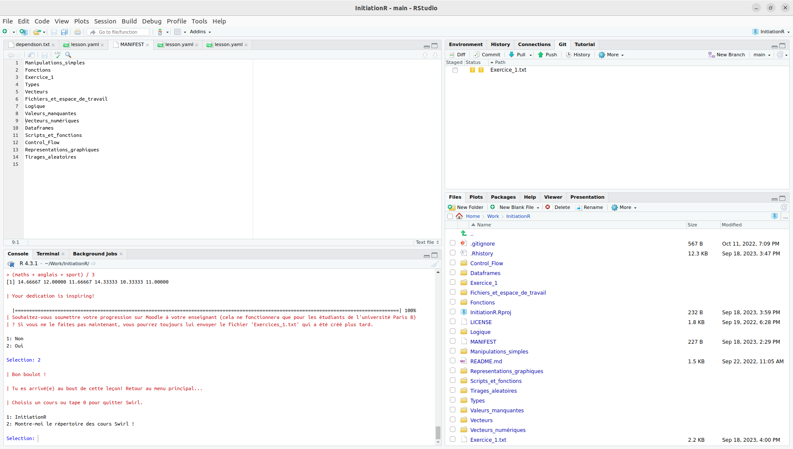

## Utilisation de `swirl` 

Si le paquet swirl n'est pas installé, installez-le à l'aide de la commande suivante dans la console

```{r}
#| echo: true
#| eval: false

install.packages('swirl')
```

Quoiqu'il arrive, exécutez les lignes suivantes dans la console :

```{r}
#| echo: true
#| eval: false

library(swirl)
uninstall_all_courses() 
```

Ici `R` vous demandera si vous voulez tout désinstaller, dites oui.
Puis tapez les lignes suivantes.

```{r}
#| echo: true
#| eval: false

install_course_github('EliasBcd', 'InitiationR')
select_language('french', append_rprofile = TRUE)
swirl()
```

Suivez ensuite les instructions qui apparaissent dans la console.
Utilisez toujours le même nom, il me permet de vous identifier.
Sélectionnez le cours `InitiationR`. 
C'est normalement le cours numéro 1.
Sélectionnez enfin la leçon correspondant à votre progression dans le cours.

## Si vous êtes bloqués {#sec-bloque}

swirl ne vérifie pas le résultat de votre commande : il compare ce que vous avez tapé à une liste de réponses qu'il connaît.
Une commande juste, qui fonctionne, peut donc être refusée si elle est écrite autrement que prévu.

Quand swirl refuse votre réponse :

1. **Relisez la consigne mot à mot.** Les noms demandés (d'objet, de colonne, de résultat) doivent être repris exactement.
2. **Écrivez la commande comme dans le cours** : le tuyau `|>` plutôt que `%>%`, et sans étape supplémentaire.
3. **Lisez l'indice** que swirl affiche après une mauvaise réponse : il précise souvent la forme attendue.
4. **Si vous tournez en rond, passez la question** en tapant `skip()`. swirl exécute alors la bonne réponse à votre place et passe à la suite. Regardez bien la commande qu'il exécute : c'est ainsi que vous comprendrez ce qui coinçait.

Passer quelques questions n'est pas un problème : environ une question sur cinq reste acceptable.
Au-delà, reprenez plutôt la séance correspondante avant de continuer la leçon.

Quelques autres commandes utiles, à taper à l'invite `>` pendant une leçon :

| Commande | Effet |
|:--|:--|
| `skip()` | passe la question en cours |
| `play()` | vous laisse taper des commandes librement, sans que swirl les corrige |
| `nxt()` | revient à la leçon après un `play()` |
| `bye()` | quitte swirl en gardant votre progression ; `swirl()` vous ramène où vous en étiez |
| `info()` | rappelle la liste de ces commandes |

## Rendu des exercices

Vous devez déposer à la fin de chaque leçon swirl le fichier .txt généré sur Moodle, [ici](https://moodle.univ-paris8.fr/mod/assign/view.php?id=271762)

Le fichier s'appelle en général `nom_de_la_leçon.txt` et apparaît à la racine de votre dossier personnel.
Ici, par exemple, le fichier `Exercice_1.txt`. On le trouve sur l'onglet en bas à droite, dans l'onglet File.



Vous pouvez ensuite le déposer sur Moodle, dans le devoir "Suivi de la Progression".
Vous pouvez déposer plusieurs fichiers, cela ne pose pas de problème, tant qu'ils ont des noms différents.

## Aller plus loin

Le cours `InitiationR` propose aussi des leçons facultatives, en autonomie,
pour qui veut pratiquer davantage ou approfondir un point (fonctions,
boucles, tirages aléatoires...). Chaque séance rappelle celles qui prennent
la suite directe de ce qui vient d'être vu. La liste complète, avec un
résumé de chaque leçon, est disponible dans
[`LECONS_OPTIONNELLES.md`](https://github.com/EliasBcd/InitiationR/blob/main/LECONS_OPTIONNELLES.md)
sur le dépôt du cours.